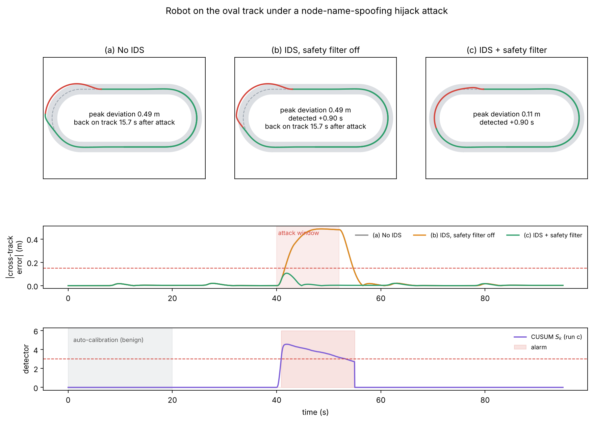

# Cross-Layer Intrusion Detection for ROS 2 Robotic Networks

A cross-layer intrusion detection system (IDS) for differential-drive robots
running on ROS 2 / DDS. It fuses **network-layer evidence** (who is publishing,
discovery and traffic rates) with a **physics-layer check** (is the robot moving
the way the authorized controller told it to) to catch command-injection and
spoofing attacks that are invisible to packet inspection alone, and blocks them
inline with a safety filter.

Mini-project for **21ECC402P — Computer Communication and Network Security**,
SRM Institute of Science and Technology.
Author: **Shyam Rithin S** (RA2311004010308).

---

## Why

ROS 2 moves all data over DDS, which runs on UDP and performs **no
authentication by default**. Any node that can reach the network can publish to
`/cmd_vel` and the robot obeys. A spoofed command is a *syntactically valid*
packet, so network IDS cannot tell it from a real one.

- **Network-only IDS** (ROSPaCe, RIPS) never sees the robot's motion.
- **Control-theoretic detectors** (CUSUM, watermarking) never see the network.

This project fuses the two on ROS 2 and shows, by ablation, that **each layer
catches attacks the other is blind to**:

| Attack | Network layer | Physics layer | Fused |
|---|---|---|---|
| Discovery flood | detected | missed | detected |
| Compromised / spoofed node | missed | detected | detected |

The threshold is calibrated from **benign data only** (mean + 3σ) — no labelled
attack data is required.

---

## Repository layout

```
ros2-cross-layer-ids/
├── src/physguard/          ROS 2 package (colcon)
│   ├── physguard/          detector, safety filter, pure pursuit, attack
│   │                       injector, track geometry, simulators, offline eval
│   ├── launch/             track_demo.launch.py, demo.launch.py
│   ├── worlds/             generated Gazebo oval-track world
│   ├── rviz/               RViz2 config
│   ├── tools/              wire_collector.py (tshark DDS sensor),
│   │                       gen_track_world.py
│   ├── TRACK_DEMO.md       step-by-step demo runbook
│   └── RUNBOOK.md          original detector runbook
├── console/                web attack/analysis console (stdlib, no deps)
│   ├── ids_console.py
│   ├── attacks.json        catalogue of 26 attacks + 5 network tools
│   └── index.html
└── docs/                   result figures
```

> The ROS 2 package directory is still named `physguard` internally so existing
> builds keep working; the product name is not used anywhere user-facing. A
> clean rename is a tracked follow-up.

---

## Quick start (single laptop)

```bash
# build
mkdir -p ~/ids_ws/src && cp -r src/physguard ~/ids_ws/src/
cd ~/ids_ws && colcon build --symlink-install && source install/setup.bash

# DDS environment (domain 42, Fast DDS forced onto UDP so traffic is visible)
source tools/ids_env.sh      # see src/physguard/TRACK_DEMO.md

# run: robot follows the oval track, IDS inline, RViz2 shows it
ros2 launch physguard track_demo.launch.py sim:=fake     # or sim:=gazebo
```

Wait for `IDS armed` (≈20 s of self-calibration), then in another terminal:

```bash
ros2 run physguard attack_injector
ros2 param set /attack_injector mode hijack      # attack
ros2 param set /attack_injector mode none        # stop; robot recovers
```

Full walkthrough: [`src/physguard/TRACK_DEMO.md`](src/physguard/TRACK_DEMO.md).

---

## Attack console (two-laptop setup)

Run **Gazebo + RViz2 on the robot laptop**, and the console on a **second
laptop** that acts as the attacker/analyst station. See
[`console/README.md`](console/README.md).

```bash
cd console && python3 ids_console.py           # open http://<laptop-ip>:8088
python3 ids_console.py --dry-run               # preview commands, run nothing
```

The console groups 26 attacks (command injection, identity/spoofing,
DDS/discovery, network-layer) plus standard network tools (tshark, nmap,
iperf3, hping3, tc), shows the exact command for each, launches them **by id
only** (never arbitrary text), and displays the live detector verdict.

---

## Results (simulation)

- Threshold auto-calibrated from benign driving: **ε ≈ 0.019**
- **0 false alarms** across 10 benign runs
- Hijack attack on the track detected in **~0.9 s**; stealth injection in ~1.95 s
- Peak off-track deviation **0.49 m → 0.11 m** with the safety filter on



Results are from simulation; hardware deployment is Phase 2.

---

## Scope and ethics

Every attack targets the author's **own robot** on an **isolated
`ROS_DOMAIN_ID`**. This is a defensive evaluation testbed: the attacks exist to
measure the detector. Do not run them against systems you do not own.

## License

MIT — see [LICENSE](LICENSE).
